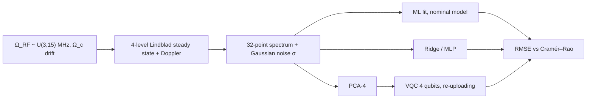
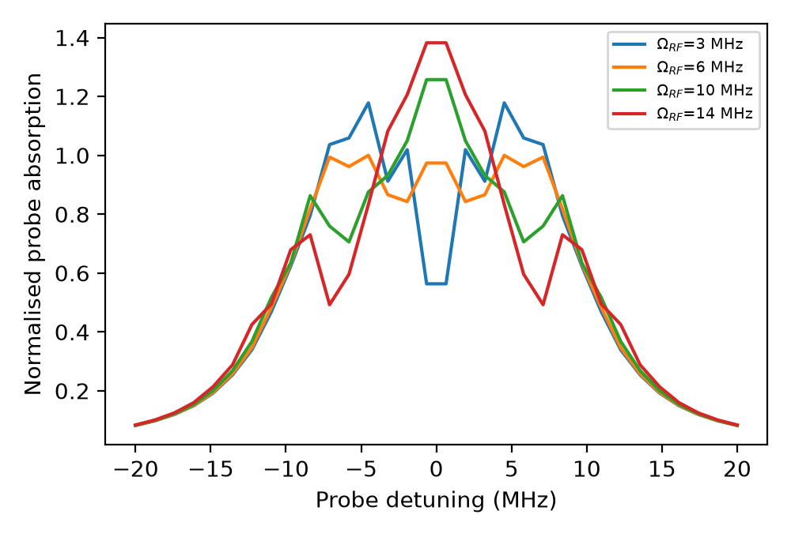
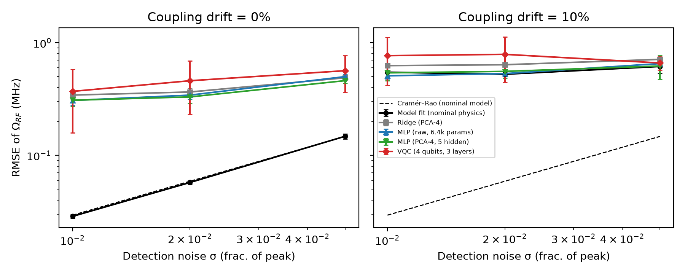
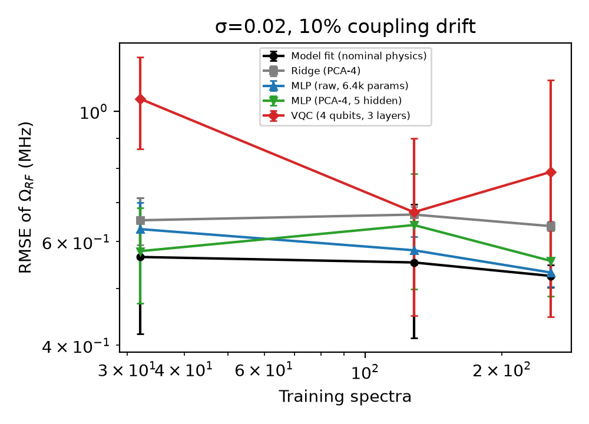
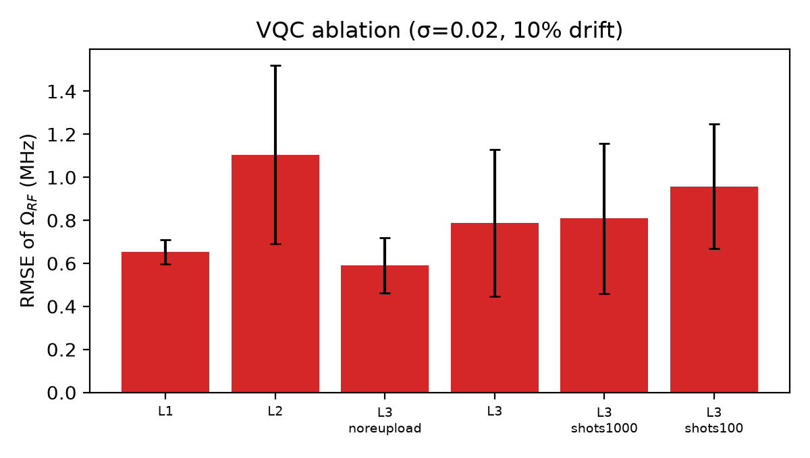

# Rydberg-EIT RF amplitude estimation: model fit vs learned vs variational-quantum estimators

  

**Abstract.** I simulate Rydberg-atom EIT / Autler–Townes spectra (four-level Lindblad model, Doppler averaged) and ask how well an RF Rabi frequency can be read out by (i) a maximum-likelihood fit of the nominal physics model, (ii) classical learners and (iii) a 4-qubit data re-uploading variational quantum circuit (VQC). Without model mismatch the physics fit sits on the Cramér–Rao bound (CRB) and every learned estimator is 5–10x worse. With 10% unmodelled coupling-laser drift the fit degrades to ~0.5 MHz, but the learned estimators, including the VQC, do not recover the loss in this small-data, simulation-only study.

## Motivation
Rydberg-atom electrometers read an RF field amplitude from the splitting of a probe-laser spectrum. Unlike typical QML benchmarks, this task has a forward model and a statistical bound, so "does a learned (or quantum) model help?" has a sharp answer. QML reviews note that results are mostly simulation-scale and promising rather than conclusive (Peral-García et al., 2024, doi:10.1016/j.cosrev.2024.100619); VQC parametrisations lack guiding principles (Meyer et al., 2023, doi:10.1103/PRXQuantum.4.010328); and it is poorly understood why VQC agents often fail to beat classical methods (doi:10.1016/j.ins.2026.124009). See `docs/RESEARCH_GAP.md`.

**Hypotheses** (all tested): H1 the fit is within ~1.5x of the CRB with no mismatch; H2 under 10% drift learned estimators beat the nominal fit; H3 the VQC matches a parameter-matched MLP.

## Method

Details in `docs/METHOD.md`. Metric: RMSE of Ω_RF (MHz) on 200 held-out spectra, mean ± std over 3 seeds, 256 training spectra unless stated. VQC: 37 parameters, 120 Adam steps, exact statevector (no hardware noise); parameter-matched MLP: 61 parameters.



## Results (all numbers from `results/summary.csv`)
RMSE (MHz), 256 training spectra, σ = 0.02 (CRB = 0.0589 MHz, `results/crb.csv`):

| Estimator | no drift | 10% Ω_c drift |
|---|---|---|
| Model fit (nominal physics) | 0.057 ± 0.002 | 0.525 ± 0.023 |
| Ridge, PCA-4 | 0.365 ± 0.028 | 0.638 ± 0.011 |
| MLP, raw (6337 params) | 0.343 ± 0.028 | 0.532 ± 0.029 |
| MLP, PCA-4 (61 params) | 0.330 ± 0.042 | 0.557 ± 0.072 |
| VQC, 4 qubits × 3 layers (37 params) | 0.460 ± 0.228 | 0.788 ± 0.341 |

Noise sweep (σ = 0.01 / 0.02 / 0.05), no drift: fit 0.029 / 0.057 / 0.148 MHz vs CRB 0.029 / 0.059 / 0.147; VQC 0.370 / 0.460 / 0.565.



Training-set size (σ = 0.02, 10% drift), VQC: 1.05 ± 0.187 (32), 0.674 ± 0.224 (128), 0.788 ± 0.341 (256); raw MLP: 0.63 / 0.58 / 0.532; fit: 0.565 / 0.553 / 0.525 (the fit does not train; its variation is from the test draw).



VQC ablation (σ = 0.02, 10% drift, 256 spectra): depth 1: 0.653 ± 0.056; depth 2: 1.105 ± 0.415; depth 3: 0.788 ± 0.341; depth 3 without re-uploading: 0.591 ± 0.127; depth 3 with 1000-shot readout: 0.809 ± 0.349; 100-shot: 0.958 ± 0.288.



## Discussion (including negative results)
- **H1 supported.** The nominal fit reaches the CRB across σ (e.g. 0.057 vs 0.059 MHz at σ=0.02).
- **H2 not supported.** Drift lifts the fit error to ~0.5 MHz, but the MLPs (0.53–0.56) only tie it, and the VQC and ridge are worse. The learners are also 5–10x above the CRB without drift, so with 256 spectra and a short training schedule they are limited by optimisation/data rather than a physics floor; I did not test larger training sets or longer training, and did not tune hyperparameters.
- **H3 not supported.** The VQC is worse than the parameter-matched MLP (0.788 ± 0.341 vs 0.557 ± 0.072) and has 3–5x larger seed-to-seed spread. No VQC depth or re-uploading setting beats the classical baselines; the no-re-uploading variant was best among VQCs, but the std is large enough that the ordering among VQC variants is not resolved by 3 seeds.
- Finite-shot readout (1000 or 100 shots) increases the VQC error, as expected.
- No quantum advantage is claimed or observed.

## Limitations
Simulation only; i.i.d. Gaussian detection noise; one drift mechanism (Ω_c); a 4-level model with fixed Doppler parameters; PCA-4 compression bottlenecks the compressed-feature learners (the raw MLP is the exception); 3 seeds; 120-step VQC training; hardware noise is not simulated in the circuit.

## Future work
Give the estimator the drift as a nuisance parameter: a model-based fit with a free Ω_c is the obvious next baseline, as is an in-situ reference spectrum. On a bench, the same pipeline would take measured probe-transmission spectra and test calibration transfer across laser-power drift, with the CRB as a live target.

## Reproducibility
```
pip install -r requirements.txt
pytest -q
python experiments/run_all.py --quick   # smoke run, well under a minute
python experiments/run_all.py           # full run: 577 s (results/meta.json)
```
Hardware: Windows 11, Python 3.11.9, 16 threads (torch uses 6), CPU only. Raw rows: `results/raw.csv`.

Related work by the author: [Hardware-Efficient-QPU-Ansatz](https://github.com/pradeepdegalaroyal/Hardware-Efficient-QPU-Ansatz), [qfc-codesign-heterogeneous-quantum-links](https://github.com/pradeepdegalaroyal/qfc-codesign-heterogeneous-quantum-links).

## Structure
```
src/rydberg_est/   physics.py (Lindblad model, CRB), estimators.py (fit, ridge, MLP, VQC)
experiments/       run_all.py, make_figures.py
tests/  docs/  results/  figures/  .github/workflows/ci.yml
```

## Citation

If you use this code, please cite it (see also `CITATION.cff`):

```bibtex
@software{chenchupradeep2026rydbergeitrf,
  author  = {Chenchupradeep, Degala},
  title   = {Rydberg-EIT RF amplitude estimation: model fit vs learned vs variational-quantum estimators},
  year    = {2026},
  version = {0.1.0},
  url     = {https://github.com/pradeepdegalaroyal/rydberg-eit-rf-estimation-vqc-vs-fit},
  license = {MIT}
}
```

MIT license (`LICENSE`).
